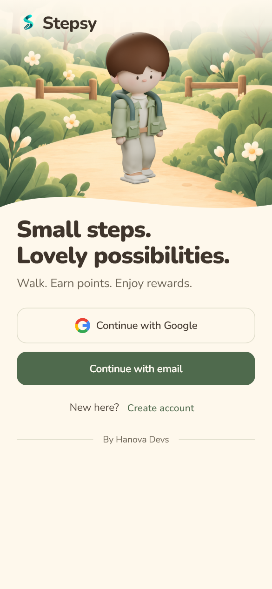
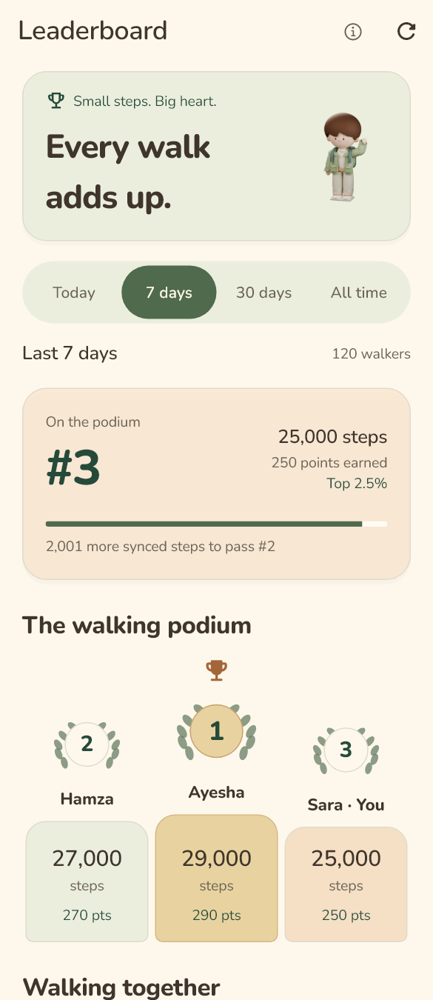

# Welcome, daily walk and achievements — 31 October 2026

The owner requested a better welcome illustration, less front-page context and a leaderboard that feels like a place for achievement. Small info icons now hold optional explanations. Sage, cream and peach, Nunito typography and the existing account/reward rules remain in use.

<table><tr>
<td></td>
<td></td>
<td></td>
</tr></table>

These previews use fictional accounts, activity and offers, not live partnership or achievement claims.

## Welcome

A dedicated 640px transparent render from the editable 3D character replaces the side-facing walking-cycle pose on Welcome. The body turns 48 degrees and the head turns back 15 degrees toward the viewer. A smaller scale, visible shoes, foreground path, cream wordmark fade and soft contact shadow improve placement. [render_welcome.py](../../design/cozy-companion/render_welcome.py) reproduces it from the existing Blender master; the horizontal Steps walking atlas is unchanged.

The shorter hero leaves more space for authentication actions. Google/email handlers, loading/error states and email verification continue through the established flows.

## Daily Steps

The main hierarchy is today's walk, live count/goal, companion trail, sync status and reward goal. Repeated explanatory paragraphs move behind accessible **info** buttons. Sync help reads the current conversion, earning cap and pending-step count; streak help explains its threshold.

**Activity details** expands for synced history, range filters, estimates and their explanations. Weekly trends, the leaderboard link, Stop/Resume and battery access remain reachable. Sync failures, missing permission, paused tracking and vehicle warnings remain visible. Tracking help retains the full background/Redmi instructions. The guided tour keeps its real targets and explains the new detail locations.

## Leaderboard

A companion/trophy header, laurel medals and warm podium pedestals establish the achievement setting. The personal-place card uses server rank, eligible steps, confirmed points and percentile. A next-place gap appears only when the adjacent higher rank is present in returned data. Ties keep their **server ranks**; positions are not invented from array indexes.

The period selector adapts to narrow screens and large text. Scoring help explains rolling windows, Pakistan-time day boundaries and earning limits. Previous-period results are hidden while a new period loads; same-period refresh failures show the last loaded results with a notice and retry. Empty states do not invent participants or prizes. Remaining rankings use a lazy sliver list; long names have wrapping/tooltips, and large text gets full-width podium rows.

No API, ranking reward, earning multiplier or admin campaign is introduced.

## Verification

- Analyzer: no issues; full Flutter suite: **169 passed**, including seven new leaderboard UI checks for help, ties, scope races, retry, empty states and narrow/200%-text layouts.
- Existing auth, live-counting/animation, redemption, Wallet, Maps, account and 20-stop tour checks pass. Pending-step guidance is verified through the info sheet.
- Arm64 profile APK built and installed with `adb install -r`, retaining **587 steps**, five days of history and enabled/not-paused flags. SHA-256: `6af1f67104a034b6c5408e9077de1653a8f96f7e742745b107fb02843b9dfe30`.
- Post-open sampling found the foreground tracking service running and no sampled fatal, unhandled Flutter or layout-overflow errors.
- Owner review of info sheets, Activity details, leaderboard and live counting is pending. TalkBack and long-duration performance require separate physical observations.
