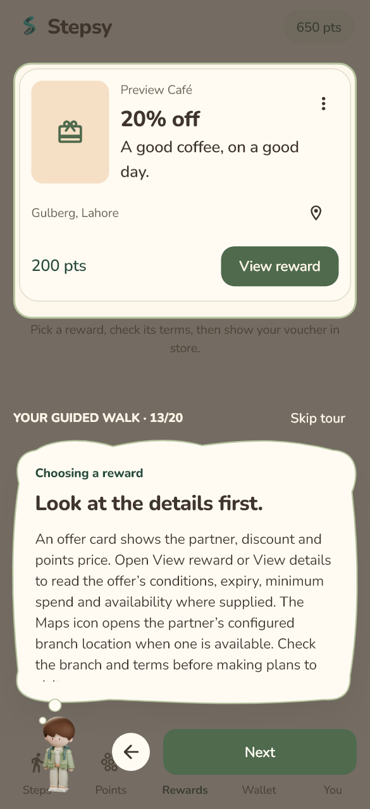

# Your guided walk — 31 October 2026

Stepsy's customer tour uses the current sage-clothed character, cream thought clouds and a sage spotlight around real app sections. It is an explanation layer over the five customer tabs. It does not create demo rewards or automate purchases, sign-out, permissions or tracking controls.

This preview uses fictional customer, points and offer fixtures. It is not a live partnership or reward-availability claim.

## First visit and replay

After the existing introduction/permission onboarding, a customer's first Steps visit offers the tour. The introduction has **Show me around** and **Skip tour**. Existing customers without a tour checkpoint also receive this one-time introduction after updating. Skipping or completing prevents automatic replay for that account on this phone.

**You → Replay guided tour** starts again from the welcome stop. **Next** advances deliberately; the back-arrow button revisits an earlier explanation. The final **Let's walk** closes the tour and returns to the top of Steps. Android Back dismisses the tour. There is no timed auto-advance or typing effect that holds up reading.

Each stop saves an account-scoped checkpoint under `stepsy.guided-tour.v1.<userId>` in local preferences. An unfinished tour resumes at its saved stop, including its correct tab. Customer/merchant account reservations, steps, points and vouchers are independent of this checkpoint. Merchant and signed-out sessions do not receive the customer tour. A corrupt checkpoint falls back to a fresh skippable tour; a failed save does not trap the user in the overlay.

## What the character teaches

| Stops | Sections and explanations |
| --- | --- |
| 1–2 | Welcome, reading at your own pace and the five-tab navigation |
| 3–6 | Live sensor steps, personal goal, companion trail and syncing versus confirmed points |
| 7–9 | Pinning a reward goal without reserving stock, weekly trends, earning rules and tracking controls |
| 10–11 | Available balance, earnings, spending and the points ledger |
| 12–14 | Search/affordability filters, offer terms, branch Maps, explicit confirmation, one claim per offer and purchase recovery |
| 15–16 | Ready versus history vouchers, validity, private QR/short-code use and merchant-confirmed single-use redemption |
| 17–20 | Personal settings, notifications, privacy, account/device policy, sign-out/deactivation and replay |

The explanation uses the app's actual earning settings rather than asserting a fixed conversion or cap in the tour. Empty catalogs and wallets remain real empty states. Missing targets do not prevent continuing. An external customer-tab destination, such as a Wallet notification, ends the overlay and keeps the destination rather than redirecting the user back into the tour.

## Interaction and accessibility

- Highlighted controls remain read-only during the tour. Users leave the tour before changing settings, granting permissions or claiming rewards.
- Targets are located within each page's actual lazy scroll view. Temporary bottom spacing lets lower sections move above the thought cloud; normal page padding returns after the tour.
- Long explanations scroll inside their own cloud. The progress label, Skip, Back and Next controls remain outside that scroll area.
- The existing character clips play once for each stop; reduced-motion and companion-animation preferences are honored. Underlying page tickers pause while the overlay is visible, while native tracking continues independently.
- Underlying semantics and keyboard focus are excluded during the tour. Explanations use live-region semantics and the overlay has its own focus scope. Reading with TalkBack still warrants a physical accessibility walkthrough.

## Implementation and checks

The [guided tour feature](../../mobile/lib/features/guided_tour) contains product copy, scoped persistence, target lookup and the overlay. Existing customer screens supply stable target keys; [MainScaffold](../../mobile/lib/features/home/presentation/main_scaffold.dart) hosts the guide. [Tour tests](../../mobile/test/guided_tour_test.dart) reuse fictional screen fixtures and cover all target transitions, saved checkpoints, Back/Skip/Replay, external navigation, no reward claims or tracking-state mutations, and welcome/middle/finish controls at 200% text in narrow portrait and short landscape layouts.

Current automated validation: **162 Flutter tests passed**, including **12 tour tests**; analyzer reports no issues. The documentation checker validated 104 local targets in 36 Markdown files.

The arm64 profile APK built successfully and was installed on the Redmi Note 11 with `adb install -r`. The before/after native snapshots retained **151 steps**, five days of history and the existing enabled/not-paused flags. APK SHA-256: `ec23ffd0197ee01d5651c9496f27fe3fb8ed2972cf14a5cb47a5558d032efa26`. Post-open sampling found the foreground tracking service running and no sampled fatal, unhandled Flutter, layout-overflow or provider-during-build errors. The owner has been asked to review the character, Next/Back, Skip and live counting; physical acceptance is pending.

The first physical walkthrough exposed a disabled Next button at stop 3 with ordinary animations enabled. The page tickers were muted under the guide, and the target-finding scroll incorrectly awaited an animation on one of those paused tickers. The full-tour regression reproduced the failure after changing its fixture from reduced motion to normal motion. Target positioning now uses an immediate scroll, and target lookup releases its busy state even if a section is unavailable. The 20-stop walkthrough passes with ordinary animations enabled; the separate large-text/reduced-motion checks remain in place. The replacement APK (`d6b4ed966701a952eb3a8de02e59387b9c9195ed6018287d03742205b63f18b4`) was installed without clearing data and resumed the saved stop 3. The owner confirmed that the corrected flow worked on the Redmi.
